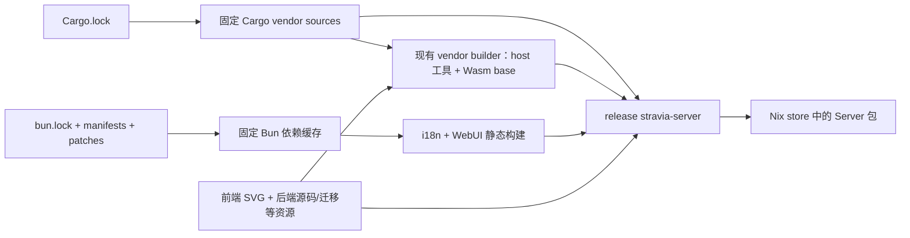

# Server flake 打包设计

研究与实施日期：2026-10-19。状态：设计已确认，Server flake 与 NixOS module 已实现；实际验证与限制见第 9 节。范围按用户要求限定为 **Server**，不包含 Desktop、开发环境迁移、Home Manager module 或开发工具包。

## 结论

已添加从源码构建完整 `stravia-server` 的 flake，支持 `nix build` 与 `nix run`。生产包保留默认 `embed-webui`，嵌入同次源码构建的 WebUI 和基础 Wasm vendor，不下载 GitHub Release 二进制，也不依赖工作区已有的 `dist`、`target` 或缓存。[R1][R2][R3]

借鉴 omp 的 **固定输入、Bun 离线依赖、Cargo vendoring、显式构建阶段和锁文件一致性检查**，不移植其 CLI 原生 addon、CUDA、音频、Darwin 修补或用户配置模块。参考源码固定为 `can1357/oh-my-pi@1d5aff90b057ce7dbfe32ea557a527c1b3144b72`，避免浮动分支使结论失去依据。[O1][O2]

本仓库已有 `devenv.nix`、`devenv.yaml`、`devenv.lock` 和 `.envrc`；它们继续负责开发工具、端口分配、worktree 初始化与 PostgreSQL。新 flake 负责 Server 打包及可选的 NixOS service，不输出第二套 dev shell，也不改变现有开发入口。直接 `nix run` 与导入服务模块是两个独立消费者。[R4]

## 1. 已确认的仓库约束

| 约束 | 证据与设计影响 |
|---|---|
| Rust 固定为 1.99.1，包含 `wasm32-wasip2` | 从 `rust-toolchain.toml` 读取，不手写另一份版本；仅使用 nixpkgs 默认 Rust 不能保证一致。[R5] |
| Bun 固定为 1.4.2 | 根 `package.json` 的 `engines.bun` 与 `packageManager` 一致。flake 对实际 Bun 版本做断言，沿用现有 devenv 的做法。[R4][R5] |
| 生产 Server 默认嵌入 WebUI | `embed-webui` 为默认 feature，资源由 release 构建的 `RustEmbed` 读取。`--no-default-features` 或 debug 构建不能代表完整生产包。[R2] |
| Core 编译前必须存在基础 vendor | `stravia-core/build.rs` 读取仓库根 `target/vendor-plugins/manifest.json`，验证组件哈希并嵌入 `base`。不能只运行 `cargo build -p stravia-server`。[R3] |
| vendor 构建包含第二次 Cargo 调用 | `stravia-build-vendors` 启动 `cargo build --locked --release --lib --target wasm32-wasip2`，使用独立 guest target 目录，并移除宿主 `RUSTFLAGS`；默认只构建基础包，不应替换为开发环境的 `--all`。[R3] |
| WebUI 是 Bun workspace | 从仓库根安装，保留根与 WebUI 清单、`bun.lock`、patches；不要在 WebUI 子目录重新解析一套依赖。[R6] |
| i18n 生成需要可写依赖目录 | `compile-i18n.ts` 会写入 WebUI 的 `node_modules/.stravia-inlang-message-format.js`，然后生成 Paraglide；直接把整个依赖目录链接到只读 store 不符合该契约。[R7] |
| 前端包含 native optional dependencies | `bun.lock` 包含 Tailwind oxide、LightningCSS 等平台包；还包含 `@wdio/tauri-service` patch。不能因为只打 Server 就擅自删除锁文件中的桌面测试依赖或 patch。[R6] |
| Rust 构建还读取前端源资源 | Docker 构建显式保留原始 SVG 图标和 logo；仅传入编译好的 WebUI 不够。[R1] |

现有生产构建入口为 `task build:server`。实际 dry-run 打印的步骤是安装 WebUI 依赖、构建基础 vendor、构建 WebUI、release 构建 Server；WebUI 与 vendor 可独立准备，最终 Server 必须等待两者。[R1]

## 2. 参考 omp：借什么，不借什么

omp 的 flake 将 toolchain 与 Bun 依赖准备交给 `nix/package.nix`，使用 `rustPlatform.importCargoLock`、`cargoSetupHook` 与 `bun2nix.hook`，显式执行 Rust 和 Bun 构建。其 `bunInstallFlags` 使用 `--backend=copyfile`，避免 Nix store 权限与链接后端问题；Bun patch 通过 `patchedDependenciesToOverrides` 纳入依赖缓存。[O1][O2]

这些机制适合 Stravia。相反，omp 最终生成 Bun executable，并压入 Rust native addon，还需要 ELF/Mach-O 修补与运行库保活；Stravia Server 是 Rust 可执行文件，WebUI 和 Wasm 是编译期资源，没有理由复制那些步骤。[O2]

omp 导出了四个平台、dev shell、overlay 和两个用户配置模块。这些不是添加 flake 的必要条件。本次只设计 Linux Server 包，默认与具名输出指向同一 derivation，不添加额外产品目标。[O1]

另一个重要限制：参考版本的 omp Nix workflow 只执行全平台 `--no-build` 评估和 Bun 锁生成检查，不能据此证明其所有平台包都构建成功。Stravia 的验收必须实际构建并启动 Server。[O3][N1]

## 3. 输出与文件边界

包输出平台为 `x86_64-linux`、`aarch64-linux`，与现有 Linux GNU Server 发行架构一致；两者都需要相应平台的构建验证，可使用原生/远程 builder 或明确配置的仿真执行环境。实际证据见第 9 节，不将“能枚举平台”或用户态仿真视为原生硬件构建证明。[R8]

输出保持最小：

- `packages.<system>.stravia-server`：完整生产 Server。
- `packages.<system>.default`：同一 Server 包，供 `nix build` 使用。
- 包设置 `meta.mainProgram = "stravia-server"`，使 `nix run` 可直接运行；不必再维护一份重复的 `apps` 定义。[N2]
- `checks.<system>.server`：同一 Server derivation，确保普通 `nix flake check` 包含真实构建。
- `checks.<system>.bun-lock`：用锁定的生成器重新生成 Bun Nix 依赖表达式并比较。
- `checks.<system>.service`：隔离 NixOS VM 的真实包、服务及持久状态验收。
- `nixosModules.default`：提供 `services.stravia`，配置与运行下述 Server service；不隐式启用服务。
- `apps.<system>.update-bun-deps`：维护锁依赖表达式，不是额外产品包。
- `formatter.<system>`：Nix 源文件格式化工具；生成的 `nix/bun.nix` 以生成器输出为准。

不输出 Desktop、devtools、Wasm 独立产品包、`devShells`、Home Manager module 或 overlay。Server service module 有进程、状态和网络语义，不是只把包加入 `environment.systemPackages` 的安装别名。

实施文件：

| 文件 | 职责 |
|---|---|
| `flake.nix` | 输入、平台集合、toolchain 与输出连接 |
| `flake.lock` | 固定 nixpkgs、rust-overlay、bun2nix |
| `nix/package.nix` | 私有 WebUI derivation 和最终 Server derivation，显式组织构建顺序 |
| `nix/bun.nix` | 从 `bun.lock` 生成的带哈希依赖表达式，不手工维护依赖清单 |
| `nix/nixos-module.nix` | `services.stravia` 选项、systemd unit、服务身份与状态目录 |
| `nix/bun2nix.nix`、`nix/bun2nix-lockfile-v2.diff` | 对固定生成器的局部 v2 兼容补丁，仍拒绝 v3 |
| `nix/tests/service.nix` | 隔离 VM 中的 Server 消费者与部署边界验收 |

WebUI derivation 放在 `nix/package.nix` 的局部定义中即可，不先拆出多层 helper、额外配置项或通用 Rust 打包框架。它只是 Server 的构建输入，不是新增对外产品包。

## 4. 构建链



### 4.1 WebUI：独立构建输入

使用 `bun2nix.fetchBunDeps` 准备离线缓存，以 hook 在可写构建目录安装 workspace，然后执行现有 `bun run build:web`。该脚本已包含 i18n 生成，无需为 Nix 重新实现前端构建。[N3][R6][R7]

- 将根 `patchedDependencies` 转为 bun2nix overrides，保留实际 patch 文件。omp 已有对应实现可参考。[O2]
- 优先使用 `--backend=copyfile`，并保证 WebUI 的 `node_modules` 父目录可写；安装布局以现有 workspace 的实际构建结果为准，不盲目照搬 omp 的 linker 选择。[O2][N3]
- 审查所锁定版本 hook 的 lifecycle scripts 行为，不为避免联网而一律禁用所有脚本，也不允许安装阶段临时下载未固定的二进制。[N3]
- 在 lifecycle scripts 前以 `autoPatchelfHook` 修补 GNU native bindings，提供实际的 GCC 运行库。Bun 同时安装 GNU 和 musl optional packages，不能对整个 `node_modules` 统一修补，也不能忽略缺库错误。Tailwind/LightningCSS 已经过真实构建验证，不使用全局 `LD_LIBRARY_PATH`。[N4]
- 安装产物只保留 `dist`。最终 Server 运行不需要 Bun、`node_modules` 或前端编译器。

独立 WebUI derivation 的收益是：后端源码改变不必重新安装并编译前端。要实现这一点，其 `src` 也必须过滤为真正的前端构建输入；仅拆 derivation、却传入整个仓库源码，仍会随后端源码变化而失效。必须保留 workspace manifests、锁文件、patches、WebUI 源码、messages、project.inlang、静态资源和构建配置。[R6][R7]

### 4.2 Rust：一个 derivation 顺序构建 vendor 和 Server

优先沿用 omp 的 `stdenv.mkDerivation` + `rustPlatform.importCargoLock` + `cargoSetupHook`，显式控制多阶段 Cargo 调用。当前没有证据表明需要引入 crane 或依赖缓存框架。`buildRustPackage` 也支持 `cargoLock`，但本仓库仍需额外处理嵌套 Wasm、预生成 manifest 和 WebUI 注入，不能把默认 Cargo build hook 当成完整方案。[O2][N5]

在同一个可写源码目录中，复用同一份根 Cargo 锁与 vendor sources，按顺序完成：

1. 将 WebUI 输出放入 `frontend/stravia-webui/dist`，保留 Rust 需要的原始前端资源。
2. 设置离线 Cargo 环境，运行现有 `cargo run --locked -p stravia-vendor-base --bin stravia-build-vendors`。
3. 由该工具生成真实的 Wasm base、内容哈希文件名及 `target/vendor-plugins/manifest.json`，不要在 Nix 中复刻 manifest/哈希算法。
4. 运行 `cargo build --locked --release -p stravia-server --bin stravia-server`，保留默认 features。
5. 将唯一的产品可执行文件安装到 `$out/bin/stravia-server`，附项目许可证。

离线约束必须覆盖外层 Cargo、host vendor builder 和它启动的 guest Cargo。Nix 构建 hook 可能设置宿主 target、Cargo config 或 flags；需要确认 guest 调用继续命中同一 vendor sources，并没有继承不适用的宿主链接参数。`--locked` 只禁止修改锁文件，不能代替离线依赖供应。[R3][N5]

不在 sandbox 中运行 `rustup target add`、`bunx` 拉取 CLI、普通在线依赖安装或整个 `task build:server`。Taskfile 仍是构建语义来源，但它的开发式依赖安装步骤由 Nix 的固定来源替代；实际生成器与编译命令继续复用。[R1]

## 5. 输入、版本与源码边界

推荐只引入 `nixpkgs`、`rust-overlay`、`bun2nix`；子输入的 nixpkgs 尽量 `follows` 顶层输入。用 `rust-overlay` 的 `fromRustupToolchainFile` 读取现有 Rust 清单；Bun 从锁定 nixpkgs 获取并断言满足 `package.json`。[O1][R4][R5]

初始 flake pin 采用现有 `devenv.lock` 的底层 nixpkgs revision `8edc0c72e3a38faf5434e40d1f19431125fe4b30`，提供 Bun 1.4.2；不因 omp 使用 `nix-bun` 就新增第四个输入与另一份 Bun 版本路径。[R4][O1]

固定 bun2nix 2.1.2 原本拒绝本仓库的 lockfile v2。Bun 上游说明 v2 仅收紧解析校验，v3 才改变 overrides 结构；局部补丁只将版本门禁从 v1 扩展为 v1/v2，不改依赖解析，也不降级 `bun.lock` 的版本标记。使用 `nix run .#update-bun-deps` 更新生成物；v3 的实际拒绝探测仍返回非零。[N8]

`devenv.lock` 与 `flake.lock` 分别服务开发环境和发行包，不会自动同步。保留两者，不在求值时解析开发机状态，也不把前者伪装成后者。[N6]

源码过滤不得误删：Cargo workspace 所有成员清单及本地 path dependencies、`.cargo/config.toml`、build scripts、WIT/messages、迁移、后端嵌入资源、前端原始 SVG、生产 WebUI 构建输入。Nix flake 的 Git 输入只包含被跟踪文件，当前被忽略的 `target`、`dist`、Paraglide 目录都必须在构建中重新生成。[R1][R3][R7][N7]

不得把 `.env`、`.stravia-dev`、数据库、用户配置或其他凭据送入 Nix store。不要改为 `path:.` 纳入整个工作区来绕过未跟踪源码问题；新增 Nix 文件须纳入 Git 跟踪后再做正常本地 flake 验证。直接调用 `builtins.getFlake` 时也应使用 Git reference，而不是复制整个工作区的绝对 path reference。[N7]

不复制 omp 的 `nixConfig` 来自动引入第三方缓存与信任键；包正确性不应依赖额外缓存信任。是否启用缓存由使用者另行配置。[O1]

## 6. 运行时边界

- 保持现有 CLI 参数和 `STRAVIA_*` 环境变量，不新增包装层去改变绑定地址、端口或数据目录。`nix run` 仍默认监听 `127.0.0.1`，数据目录由现有规则或调用者参数决定，不写入 store。[R9]
- 不在包构建或首次运行时自动创建应用管理员、预置认证凭据、启动数据库或连接生产服务。既有 SQLite/PostgreSQL、认证和管理初始化契约不变；NixOS module 创建的 Unix 服务身份不等于应用管理员。
- Chrome/Chromium 是部分联网能力的运行时前提；现有实现从显式路径、`STRAVIA_CHROME_PATH` 或本机安装位置解析，不自动下载。建议 Server flake 保持这个契约，不强制将 Chromium 加入基础运行闭包，也不额外增加 browser variant。需要相关能力的部署单独提供浏览器。[R10]
- 必须验证 Nix 环境下 HTTPS 信任链与浏览器发现；不通过关闭 TLS 验证、Chrome sandbox 或 SSRF 防护使包装通过。

## 7. 实施验收，不是本次验证结果

完成上述打包时至少执行：

1. `nix flake check --all-systems --no-build`：检查两个 Linux 平台的输出可评估；不将它作为构建证明。
2. 每个声明支持的平台执行 `nix build .#stravia-server`，在启用 sandbox 的干净来源中构建，不读取已有工作区 `target`、`dist`、`node_modules` 或用户 Cargo 缓存。
3. 用 `nix run . -- --help` 核对真实 CLI；再以临时 data-dir 和 loopback 空闲端口启动同一个产品包，检查 `/healthz`、`/` 与实际前端静态资源，并在浏览器看到真实初始化/登录界面。debug/no-default-features 产物不能替代此项。
4. 重启同一隔离实例，确认 SQLite 状态留在指定 data-dir，内置 `base` vendor 可从正常运行时加载；不得伪造 manifest 或使用开发插件目录代替内嵌组件。
5. 在可控的隔离环境验证 HTTPS；需要本机浏览器功能时另行验证显式浏览器路径和 Chromium 启动，不调用生产模型服务或使用真实凭据。
6. 重新生成 `nix/bun.nix` 后无差异；锁定依赖与生成表达式不一致时 `bun-lock` 失败。patch 内容直接作为内容寻址的构建输入并实际应用；Bun v2 在锁中保存 patch 路径，不将内容变化误当成生成表达式必然变化。确认前端原生依赖和 i18n 生成经过真实构建，而不是仅做输出结构检查。

不把 Docker、PostgreSQL、Redis 或整个仓库测试矩阵强行放进 Nix sandbox。`service` 只执行隔离部署冒烟，不复制完整 WebUI E2E 或项目测试体系。

安装与维护入口见 [Nix Server 与 NixOS 服务](../design/architecture.md#nix-server-与-nixos-服务)，变更说明见 [CHANGELOG](../../CHANGELOG.md)。

## 8. NixOS service 字段设计

### 8.1 命名与配置所有权

命名空间采用 `services.stravia`，unit 为 `stravia.service`。参考固定 nixpkgs revision 的 Ollama 与 Open WebUI 模块：共同惯例是 `enable`、可替换的 `package`、`host`、`port`，以及默认关闭、独立于监听地址的 `openFirewall`；其他字段按应用语义选择，不宣称 NixOS 存在一套强制服务 schema。[S1][S2]

`enable` 使用 `lib.mkEnableOption`。`package` 为 `types.package`，默认选取本 flake 对应系统的 `stravia-server`；不假定消费者的 nixpkgs 已存在 `pkgs.stravia-server`，不要求安装 overlay 才能导入 module。[S3]

**选择应用持有 `server.toml`，module 持有进程启动参数。** 现有文件只表达数据库和缓存；它不是 CLI 参数的 TOML 镜像。首次设置会在文件所在目录创建临时文件、设置 `0600` 并原子替换原文件，因此文件本身和父目录都必须允许对应操作。不能简单用 `pkgs.formats.toml.generate` 创建一个只读 store 文件，然后传给 `--config`。[R11]

本方案不提供 `settings`、`databaseUrl`、`redisUrl`、管理员密码或 Provider/API Key 字段，不假装已支持声明式配置所有权、环境插值或 credential 合并。数据库和缓存继续由可写的 `server.toml` 配置；业务资源与认证继续通过现有管理入口维护。也不在每次启动时从 Nix store 复制配置，覆盖向导已保存的文件。

### 8.2 字段、类型、默认值与映射

下面是已实现的公共字段。运行时文件路径使用带绝对路径约束的字符串，不接收 Nix path literal，且拒绝 store 路径、根目录、换行及路径穿越；尤其不能通过 `builtins.readFile` 或路径插值把含凭据的文件内容纳入 store。[S4]

| 字段 | Nix 类型 | 默认值 | 语义与实际映射 |
|---|---|---|---|
| `enable` | `bool` | `false` | 注册并启用系统服务；关闭时不创建账户、目录或防火墙规则 |
| `package` | `package` | 本 flake 的 Server 包 | 替换实际执行的包；使用其 `stravia-server` 可执行文件 |
| `user` | 非空 `str` | `"stravia"` | Unix 服务身份，不是应用管理员；拒绝 root 及 UID 0 |
| `group` | 非空 `str` | `"stravia"` | unit 的主组及托管数据根目录组；拒绝 root 及 GID 0 |
| `dataDir` | 绝对路径 `str` | `"/var/lib/stravia"` | `--data-dir`；配置、SQLite、插件、日志和缓存的共同持久根 |
| `host` | 非空 `str` | `"127.0.0.1"` | `--host`；不随防火墙选项变化 |
| `port` | `types.port`，且不为 `0` | `23471` | `--port`；服务固定端口，不使用开发工作区的端口分配或随机端口 |
| `openFirewall` | `bool` | `false` | 仅将 `port` 加入允许的 TCP 端口；不设置监听地址、不配置反向代理或 TLS |
| `adminOrigins` | `listOf str` | `[]` | 逐项传递 `--admin-origin`；空列表表示不额外限制管理 origin，不表示关闭管理面 |
| `trustedProxies` | `listOf str` | `[]` | 逐项传递 `--trusted-proxy`；空列表表示不信任任何代理，不自动信任 loopback |
| `proxyCorsOrigins` | `listOf str` | `[]` | 逐项传递 `--proxy-cors-origin`；空列表不传此参数，沿用 Server 的本机 origin 默认值 |
| `logLevel` | `enum [ "error" "warn" "info" "debug" "trace" ]` | `"info"` | `--log-level` |
| `configPollInterval` | `ints.unsigned` | `3` | `--config-poll-interval`，单位秒；`0` 关闭轮询，不代表多副本协调 |
| `configFile` | `nullOr` 绝对路径 `str` | `null` | 非空时传递 `--config`；否则由应用使用 `${dataDir}/server.toml`，module 不读入、生成或覆盖内容 |
| `environment` | `attrsOf str` | `{}` | 非秘密附加环境，例如证书/字体等工具运行环境；不覆盖已有具名字段 |
| `environmentFile` | `nullOr` 绝对路径 `str` | `null` | 可选 systemd `EnvironmentFile`；指定文件缺失时启动失败，不加 `-` 忽略错误 |
| `browserPackage` | `nullOr package` | `null` | 非空时把该包的主程序绝对路径设为 `STRAVIA_CHROME_PATH`；不修改基础 Server 包闭包 |

默认 `stravia` 系统用户与组由 module 创建。改用其他身份时，使用者须在 NixOS 中声明相应账户与组；module 不修改自定义账户的 UID、home 或附加组。`dataDir` 默认归服务身份所有，权限为 `0700`；更改身份或目录不意味着自动迁移已有实例数据。

`configFile` 是**应用会读写的配置路径**，不是只读 secret 导入接口。不接受 `/nix/store` 下的配置，也不承诺将 `/run/secrets` 中只读文件直接用于首次向导；文件所属目录必须支持服务账户的临时文件创建与原子替换。已有完成初始化的只读配置是否可长期工作，不作为本方案的配置模式。

`browserPackage = null` 时，不要求安装 Chromium，基础 Server 仍能启动；有浏览器能力需求的系统可设为 `pkgs.chromium`。该选项只控制 unit 环境，不引入第二个包 variant。非空时，`environment`/`environmentFile` 不再同时配置 `STRAVIA_CHROME_PATH`；应用设置中的显式浏览器路径仍遵循现有更高优先级，不被 module 绕过。[R10]

### 8.3 覆盖与秘密边界

部署参数只有一份所有权：

1. 具名字段生成 CLI argv，字符串使用 systemd 执行参数转义，不拼接未经转义的 shell 命令。列表逐项传参，不用逗号拼接。
2. 对 `STRAVIA_HOST`、`STRAVIA_PORT`、`STRAVIA_DATA_DIR`、`STRAVIA_ADMIN_ORIGINS`、`STRAVIA_TRUSTED_PROXIES`、`STRAVIA_LOG_LEVEL`、`STRAVIA_CONFIG_POLL_INTERVAL`，module 不允许在 `environment` 中重复声明，并以 systemd `UnsetEnvironment` 在载入环境文件后移除同名变量。因此 `[]` 不会因为环境文件残留而变成“继承其他 origin/proxy 列表”。[S5]
3. 不把列表 `[]` 翻译为空字符串环境变量：现有 Server 实测在 `STRAVIA_ADMIN_ORIGINS=""`、`STRAVIA_TRUSTED_PROXIES=""` 下启动失败。这不是“清空列表”的受支持编码。
4. 通用附加环境同名时沿用 systemd 规则：`EnvironmentFile` 覆盖 `Environment`；它不是 shell 脚本，也不会展开变量到 TOML。具名参数的保留变量按上一条移除。[S5]
5. 不提供 `extraArgs`/`extraFlags` 重复覆盖上述参数，也不新增 `serviceConfig` 包装字段。特殊 unit 设置和平台工具的 PATH 可通过 NixOS 原生 `systemd.services.stravia` 接口配置，覆盖责任由调用者承担。

unit 使用专用临时工作目录 `/run/stravia`，由 `RuntimeDirectory` 创建，权限为 `0700`；持久根仍由显式 `--data-dir` 指定，`HOME` 指向 `dataDir`。不从调用者的仓库目录载入 `.env`，也不在运行目录部署 `.env`。这是因为现有程序在解析参数前会读取工作目录的 `.env`；仅清理进程初始环境不能阻止应用随后从该文件重新注入变量。临时工作目录不是持久配置或任务产物目录。[R9][R12]

`environment` 的值会出现在可读的 Nix 配置/unit 中，禁止放入密码、Token 或带凭据 URL。`environmentFile` 避免将文件内容直接放入 store，但环境变量本身不是 systemd 推荐的秘密传递机制，不能将其宣传为安全凭据通道。数据库/Redis 凭据留在权限受控的运行时 TOML 中；module 不新增 secret 字面值字段，也不创建应用并未消费的 `LoadCredential` 假接口。[R11][S5]

文件权限由部署负责，含凭据的 `server.toml` 应为 `0600`。环境文件保持为宿主运行时路径，例：`"/run/stravia-env"`，而不是 `./secrets.env`；不要在 Nix 表达式中读入其内容。systemd 负责读取环境文件，应用不需要获得该文件的读取权限。

### 8.4 unit 的固定语义

- `wantedBy = [ "multi-user.target" ]`，默认 `after = [ "network.target" ]`；不因支持 PostgreSQL 就隐式创建数据库、Redis 或网络依赖服务。远程数据库仍由部署管理。[S1][S2]
- 使用 `Type=exec`，不假装实现了 `sd_notify`。unit 启动不等于迁移完成或应用 ready；健康检查与就绪检查分别使用现有 `/healthz`、`/readyz`。[R13][S6]
- 使用稳定非 root 账户。默认状态目录由 `StateDirectory=stravia`、`StateDirectoryMode=0700` 管理；自定义 `dataDir` 通过 `systemd.tmpfiles.rules` 托管为 `0700`，unit 等待 tmpfiles setup 并声明挂载依赖。应用的 `ExecStartPre` 不提权，避免特权命令继承应用环境，或用 `install -d` 跟随服务用户替换的链接改写 root 目录归属；不创建另一个无用的默认目录。[S5][S7]
- `WorkingDirectory=/run/stravia`、`RuntimeDirectory=stravia`、`RuntimeDirectoryMode=0700`、`HOME=${dataDir}`、`UMask=0077`。配置、SQLite/WAL、插件和日志都写入实际 data root，而不是运行目录或 store。
- 进程异常退出可用 `Restart=on-failure`，不使用 tight restart loop、网络重试或缩短产品超时来掩盖配置错误；不新增重试参数字段。停止使用现有 SIGTERM 优雅退出，`TimeoutStopSec` 必须允许其排空，而非直接强杀。[R9][S6]
- 不照搬 Open WebUI 的整套 hardening：Stravia 使用 Wasmtime/Cranelift，并可能启动 Chromium sandbox 和平台工具。不能无条件启用 `MemoryDenyWriteExecute`、`RestrictNamespaces`、`PrivateNetwork` 或泛化 syscall allowlist；`ProtectHome`、文件系统写限制等也须按实际工具访问边界验证。禁止以 `--no-sandbox`、关闭 JIT 或吞掉执行失败作为包装修复。[R5][R10][S5]
- 首次初始化仍需要原有一次性 setup token；该 token 会进入 service journal，拥有 journal 读取权限的人是敏感运维边界。module 不预设管理员、不跳过初始化、不把 token 回显到额外文件或文档。[R9]

网络默认不扩大现有暴露范围。`adminOrigins = []` 是“不额外限制 origin”，与“默认只监听 loopback”是不同控制。公开部署须明确选择入口、反向代理信任和 TLS；不要自动设为 `["*"]`，也不因为 `openFirewall = true` 自动改成 `0.0.0.0`。[R14]

### 8.5 使用形态

下面是模块使用示例；调用者须已将 `inputs` 传入其系统模块参数：

```nix
{ inputs, pkgs, ... }:
{
  imports = [ inputs.stravia.nixosModules.default ];

  services.stravia = {
    enable = true;
    # package 默认来自同一个 flake，不要求另行安装 overlay。
    dataDir = "/var/lib/stravia";
    host = "127.0.0.1";
    port = 23471;
    openFirewall = false;

    adminOrigins = [ "https://stravia.example.com" ];
    trustedProxies = [ "127.0.0.1/32" ];
    logLevel = "info";
    configPollInterval = 3;

    # 可选；缺省时不将 Chromium 加入服务运行闭包。
    browserPackage = pkgs.chromium;
  };
}
```

该示例假定系统已有独立配置的本机 HTTPS 反向代理，代理正确覆盖 `X-Forwarded-Proto` 与 `X-Forwarded-Host`；module 不生成代理或证书。首次部署需从 journal 安全取得 setup token，经该入口完成现有设置；数据库配置默认保存到 `/var/lib/stravia/server.toml`。非代理部署不要照抄 `trustedProxies`。[R14]

### 8.6 module 验收

实施时除前述包构建验收，还应验证：

- `enable=false` 不产生 unit、账户、目录管理或防火墙修改；仅导入 module 不启动服务。
- 默认端口、loopback、用户和状态权限正确；自定义 `package`、`port`、`dataDir` 后 unit、监听地址与持久目录一致。
- `openFirewall` 仅改变对应 TCP 规则，不改变监听地址或认证；空 trusted proxy 列表不因环境文件变成非空。
- 非 root 身份能够首次设置并原子保存 `server.toml`，重启后保留 SQLite 状态；单纯健康存活不能替代 `/readyz` 或完整初始化证明。
- 特殊字符、空格及 IPv6 参数正确转义；参数不能变成 shell 或 systemd 额外指令。
- `environment` 的保留字段冲突在求值时明确报错；`environmentFile` 缺失时明确失败；unit 和 store 中没有秘密内容。
- 配置浏览器后，在实际 unit 边界内执行 Chromium 和 Wasm vendor，保持 sandbox、TLS 与 SSRF 控制；未安装浏览器时基础 HTTP 服务仍可使用。

这里需要真实 NixOS VM 或等价隔离机器的 unit 验收；单独用 `lib.evalModules` 断言几个字段不能替代 systemd、持久状态和浏览器兼容性验证。

## 9. 本次实际验证与限制

已执行并通过：

- `nix flake check --all-systems --no-build`：两个 Linux 架构的包、模块、维护命令与 checks 均可求值。
- `nix build .#checks.x86_64-linux.bun-lock --no-link`：锁定的 v2 生成器重新生成后无差异；一次性 v3 输入探测仍以退出码 1 拒绝。只在临时副本中改变一个锁定依赖的版本后，同一生成表达式比较以 `diff` 退出码 1 拒绝漂移，原锁文件未改动。
- `nix build .#checks.aarch64-linux.bun-lock --no-link`：在已配置的 ARM64 用户态仿真环境中完成生成器编译和真实依赖一致性检查；这不是 Server 包或 ARM64 VM 的构建证明。
- 一次性 NixOS 配置探测的 26 项检查：默认/自定义身份、禁用时无副作用（包含没有 tmpfiles 规则）、包覆盖、可选浏览器、保留环境变量冲突、UID 0、端口/枚举/路径边界均通过。
- `nix config show sandbox` 返回 `true`；真实源码构建完成 i18n/WebUI、嵌套 `wasm32-wasip2` base 及 release Server。修复了 GNU/musl optional packages 的修补边界，并显式提供 BoringSSL 构建脚本需要的 Git；没有忽略失败、修改锁文件或复用工作区产物。
- 启动新构建的 x86_64 Nix store Server，使用临时工作目录、临时 data root 和 loopback 随机端口：`/healthz`、`/api/v1/auth/state`、`/` 均返回 200，状态为未认证的 setup。Chromium 实际打开 `/setup` 并看到已 hydration 的令牌输入框，浏览器错误为 0。另一个独立包实例完成真实 SQLite 初始化/登录、`/readyz`、内嵌 base 就绪和配置权限 `0600` 检查。各实例 SIGTERM 后退出码均为 0，浏览器及临时数据已清理。
- `nix run . -- --help`：默认包能够通过正式 flake 入口运行；运行闭包只有 Server 与基础 C/C++ 运行库，没有 Bun、Chromium 或编译器。
- `nix build .#checks.x86_64-linux.service --no-link`：三个隔离 VM 全部通过。覆盖非 root 首次设置、配置原子保存/权限、SQLite 重启登录、内嵌 base 就绪、带空格及 `%`/`$` 的路径、IPv6、防火墙、伪造转发头、缺失环境文件、`HOME`/浏览器环境冲突和 SIGTERM。替换为不可信符号链接后，服务启动失败，运行系统 tmpfiles 也不改变 root 目标目录的属主/权限或写入配置；该用例已在原特权 `install` 实现下复现失败，再切换到系统 tmpfiles 后通过。自定义服务内的 Chromium 实际执行 JS，并在保留 sandbox 与证书校验的情况下打开测试 HTTPS 代理；真实登录请求也通过该代理验证。CA 与私钥只在 VM 的 `/run` 生成，不进入 store。修复 `EnvironmentFile` 不能按 Exec 参数加引号的问题后，负例按真实错误原因断言，而非因 start limit 误通过。
- `nix flake check -L --cores 4 --max-jobs 2`：本机 x86_64 检查全部通过，包含真实包、生成依赖一致性与 VM；不能将命令略过的异构检查视为通过。

按用户要求，不继续 ARM64 整包构建、运行或 VM 验收，保留相应 flake 输出。此前一次整包仿真构建因工具的 3600 秒限时中止；只有前述求值与 `bun-lock` 检查具备完成证据，不能宣称 ARM64 包或原生硬件验证通过。本次不运行 PostgreSQL/Redis E2E、不调用生产模型服务；Nix 不改变既有数据库和认证契约。VM 不提供外网路由/DNS，Provider Catalog 的启动刷新警告是隔离环境的预期结果，没有忽略或掩盖该错误。

## 来源

### 仓库一手来源

- [R1] [Taskfile.yml](../../Taskfile.yml)、[Dockerfile](../../Dockerfile)：完整生产构建顺序与资源输入。
- [R2] [Server Cargo.toml](../../backend/apps/stravia-server/Cargo.toml)、[Server lib.rs](../../backend/apps/stravia-server/src/lib.rs)：默认 feature 与 release WebUI 嵌入。
- [R3] [Core build.rs](../../backend/crates/stravia-core/build.rs)、[stravia-build-vendors.rs](../../backend/crates/stravia-vendor-base/src/bin/stravia-build-vendors.rs)：manifest、哈希校验与嵌套 Wasm 编译。
- [R4] [devenv.nix](../../devenv.nix)、[devenv.yaml](../../devenv.yaml)、[devenv.lock](../../devenv.lock)、[开发环境说明](../design/architecture.md#devenv-开发环境)。
- [R5] [rust-toolchain.toml](../../rust-toolchain.toml)、[package.json](../../package.json)、[Cargo.toml](../../Cargo.toml)。
- [R6] [WebUI package.json](../../frontend/stravia-webui/package.json)、[bun.lock](../../bun.lock)、[patches](../../patches)。
- [R7] [compile-i18n.ts](../../frontend/stravia-webui/scripts/compile-i18n.ts)、[project.inlang/settings.json](../../frontend/stravia-webui/project.inlang/settings.json)、[vite.config.ts](../../frontend/stravia-webui/vite.config.ts)、[.gitignore](../../.gitignore)。
- [R8] [发行说明](../releasing.md)。
- [R9] [Server main.rs](../../backend/apps/stravia-server/src/main.rs)、[data_paths.rs](../../backend/crates/stravia-core/src/data_paths.rs)。
- [R10] [browser/process.rs](../../backend/crates/stravia-web-access/src/browser/process.rs)：浏览器解析顺序、缺失时显式失败及无自动下载。
- [R11] [Server setup.rs](../../backend/apps/stravia-server/src/setup.rs)：TOML schema、数据库/缓存配置与配置文件原子保存。
- [R12] [dotenv.rs](../../backend/apps/stravia-server/tests/dotenv.rs)：工作目录 `.env` 在 CLI 解析前加载。
- [R13] [Server startup.rs](../../backend/apps/stravia-server/src/startup.rs)：启动状态与健康/就绪路由。
- [R14] [admin_entry.rs](../../backend/apps/stravia-server/src/admin_entry.rs)、[管理入口与代理信任](../design/admin-auth-bootstrap.md#管理入口与代理信任)：origin、代理列表与认证边界。

### omp 固定参考版本

- [O1] [flake.nix](https://github.com/can1357/oh-my-pi/blob/1d5aff90b057ce7dbfe32ea557a527c1b3144b72/flake.nix)。
- [O2] [nix/package.nix](https://github.com/can1357/oh-my-pi/blob/1d5aff90b057ce7dbfe32ea557a527c1b3144b72/nix/package.nix)。
- [O3] [.github/workflows/nix.yml](https://github.com/can1357/oh-my-pi/blob/1d5aff90b057ce7dbfe32ea557a527c1b3144b72/.github/workflows/nix.yml)。

### 官方文档

- [N1] [Nix 2.34：nix flake check](https://nix.dev/manual/nix/2.34/command-ref/new-cli/nix3-flake-check.html)。
- [N2] [Nix 2.34：nix run](https://nix.dev/manual/nix/2.34/command-ref/new-cli/nix3-run.html)。
- [N3] [bun2nix hook](https://nix-community.github.io/bun2nix/building-packages/hook.html)。
- [N4] [bun2nix fetchBunDeps](https://nix-community.github.io/bun2nix/building-packages/fetchBunDeps.html)。
- [N5] [当前 devenv 底层 nixpkgs revision 的 Rust 打包文档](https://github.com/NixOS/nixpkgs/blob/8edc0c72e3a38faf5434e40d1f19431125fe4b30/doc/languages-frameworks/rust.section.md)。
- [N6] [devenv 文件与变量](https://devenv.sh/files-and-variables/)、[devenv Flake 集成](https://devenv.sh/guides/using-with-flakes/)。
- [N7] [Nix 2.34：flake references 与 Git source](https://nix.dev/manual/nix/2.34/command-ref/new-cli/nix3-flake.html)。
- [N8] [Bun 上游 lockfile 版本定义](https://github.com/oven-sh/bun/blob/main/src/install/lockfile/bun.lock.rs)、[固定 bun2nix 版本门禁](https://github.com/nix-community/bun2nix/blob/0f2a1f0b6f42cebe3b149bf62d38754c5e0e9729/programs/bun2nix/src/lib.rs)。

### NixOS service 与 systemd

- [S1] [固定 nixpkgs revision 的 ollama.nix](https://github.com/NixOS/nixpkgs/blob/8edc0c72e3a38faf5434e40d1f19431125fe4b30/nixos/modules/services/misc/ollama.nix)。
- [S2] [固定 nixpkgs revision 的 open-webui.nix](https://github.com/NixOS/nixpkgs/blob/8edc0c72e3a38faf5434e40d1f19431125fe4b30/nixos/modules/services/misc/open-webui.nix)。
- [S3] [固定 nixpkgs revision 的 lib/options.nix](https://github.com/NixOS/nixpkgs/blob/8edc0c72e3a38faf5434e40d1f19431125fe4b30/lib/options.nix)：`mkEnableOption` 与 `mkPackageOption`。
- [S4] [Nix path 转为字符串时的 store 导入语义](https://nix.dev/manual/nix/2.34/language/builtins.html)。
- [S5] [systemd.exec(5)](https://www.freedesktop.org/software/systemd/man/260/systemd.exec.html)：目录、环境、凭据、`UnsetEnvironment` 与运行限制。
- [S6] [systemd.service(5)](https://www.freedesktop.org/software/systemd/man/260/systemd.service.html)：`Type=exec`、重启与停止语义。
- [S7] [tmpfiles.d(5)](https://www.freedesktop.org/software/systemd/man/260/tmpfiles.d.html)、[systemd-tmpfiles(8)](https://www.freedesktop.org/software/systemd/man/260/systemd-tmpfiles.html)：目录规则、字段转义与只执行指定创建规则的语义。
